# ONERA M6 Wing — Transonic CFD & Experimental Validation

**ANSYS Fluent · compressible aerodynamics · RANS turbulence modelling · mesh verification · experimental comparisons**

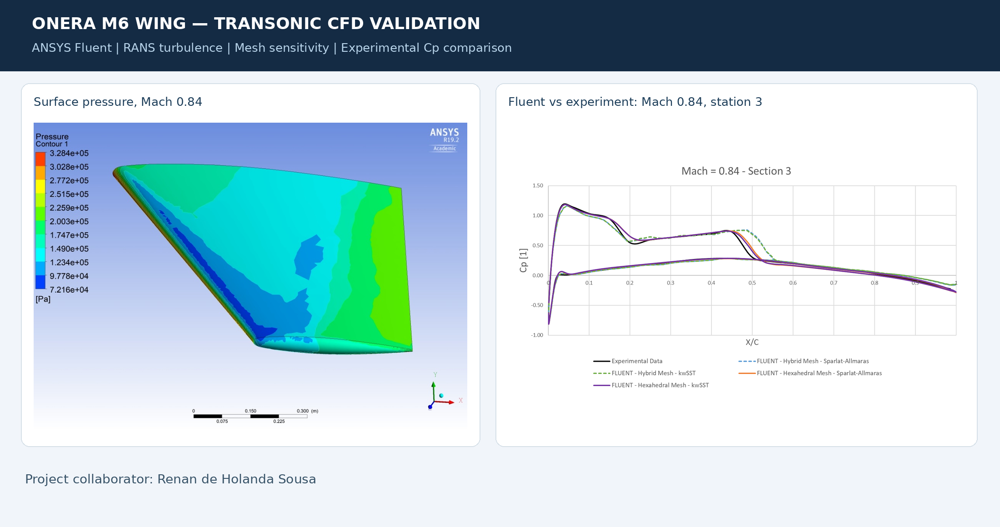

A CFD study of transonic flow over the **ONERA M6 swept wing**. We investigated how mesh type, turbulence treatment and viscous versus inviscid modelling influence wing-surface pressure predictions, and compared computed pressure coefficients with **published wind-tunnel experiments**.

**Project collaborator:** Renan de Holanda Sousa.

## Study at a glance

| Item | Setup reported in the presentation |
| --- | --- |
| Solver | **ANSYS Fluent** |
| Geometry | ONERA M6 wing, symmetric half-domain with pressure farfield |
| Flow | Steady, compressible; ideal gas, constant viscosity assumption |
| Freestream Mach numbers | **0.84**, **0.88** |
| Angle of attack | **3.06°** |
| Reynolds number | **11.72 × 10⁶** (M=0.84), **11.77 × 10⁶** (M=0.88), as stated in project slides |
| Turbulence models | Spalart–Allmaras and **k–ω SST**; additional Transition SST comparison |
| Meshes | Tetrahedral, hexahedral, and hybrid; reported sizes approximately 295k–848k elements/nodes |
| Near-wall setup | **Target** y⁺ ≈ 1; hybrid mesh with 20 near-wall layers and growth rate 1.15 |
| Validation | Surface pressure coefficient **Cp** at span stations 1, 3 and 6; Schmitt & Charpin experimental reference curves |
| Verification | Multi-mesh drag-force study described using the Celik/Richardson-extrapolation approach |

### Main questions

1. How do grid topology and near-wall refinement affect predicted shock position and surface pressure?
2. How closely do **Spalart–Allmaras** and **k–ω SST** predict the measured pressure distribution?
3. How do **viscous/RANS** results compare with the **inviscid** approximation?
4. How does Mach number affect the shock system on a swept wing?

## Mesh and solution visualizations

| Hybrid mesh | Leading-edge refinement |
|:---:|:---:|
| 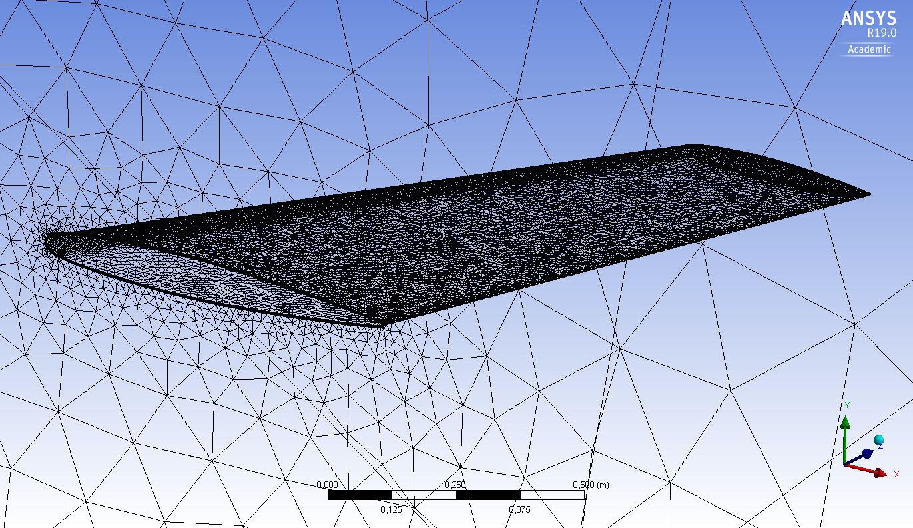 | 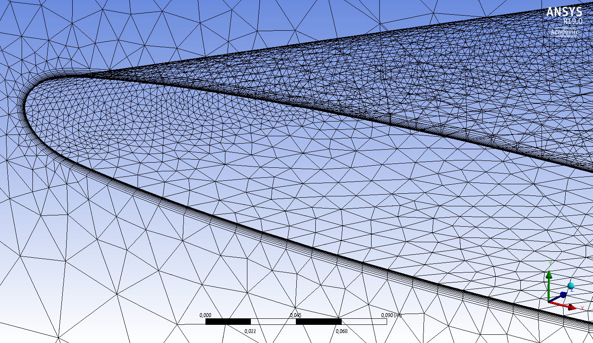 |

| Convergence-history plot | Wing pressure contour at M=0.84 |
|:---:|:---:|
| 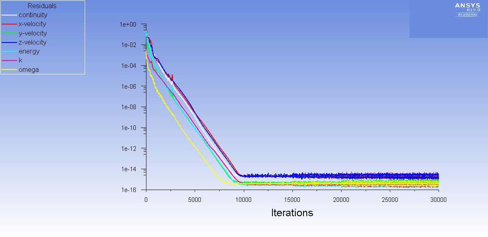 | 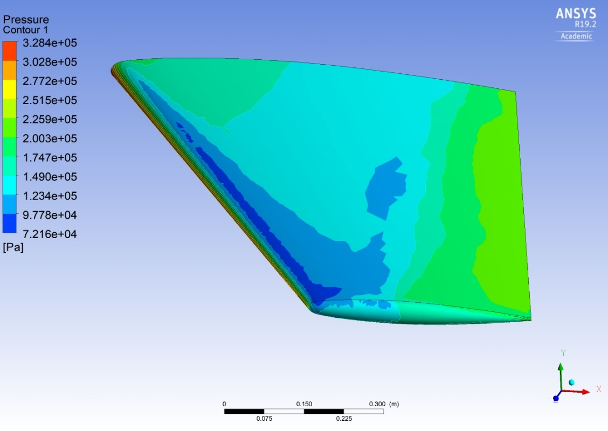 |

These are the **original output figures**, taken from the original project presentation. They were not regenerated from Fluent case files.

## Experimental validation: surface-pressure coefficient

The figures compare **Fluent predictions** from different mesh/turbulence-model combinations against the **experimental curves** included in the original presentation. The black/experimental series is a historical reference measurement, **not** a new experiment performed by the project authors.

### Mach 0.84, α = 3.06°

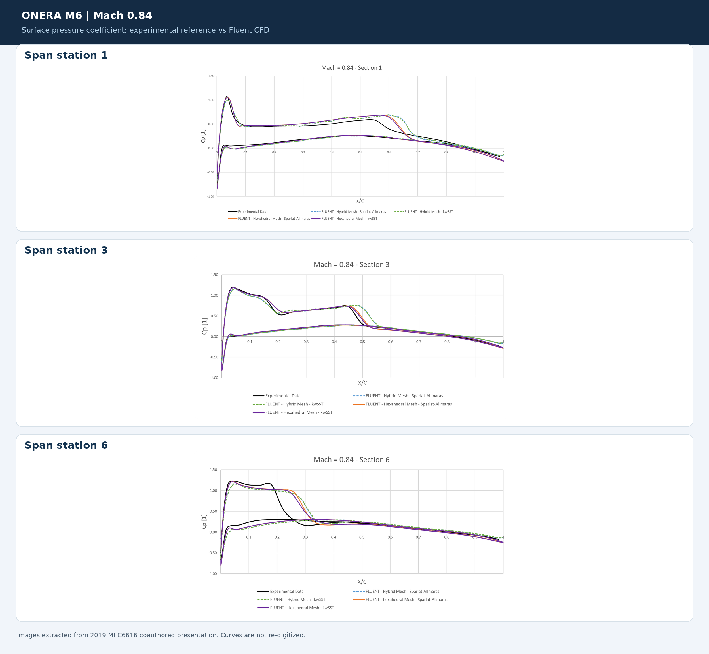

Individual, full-resolution figures: [station 1](cp_m084_station1.png) · [station 3](cp_m084_station3.png) · [station 6](cp_m084_station6.png).

### Mach 0.88, α = 3.06°

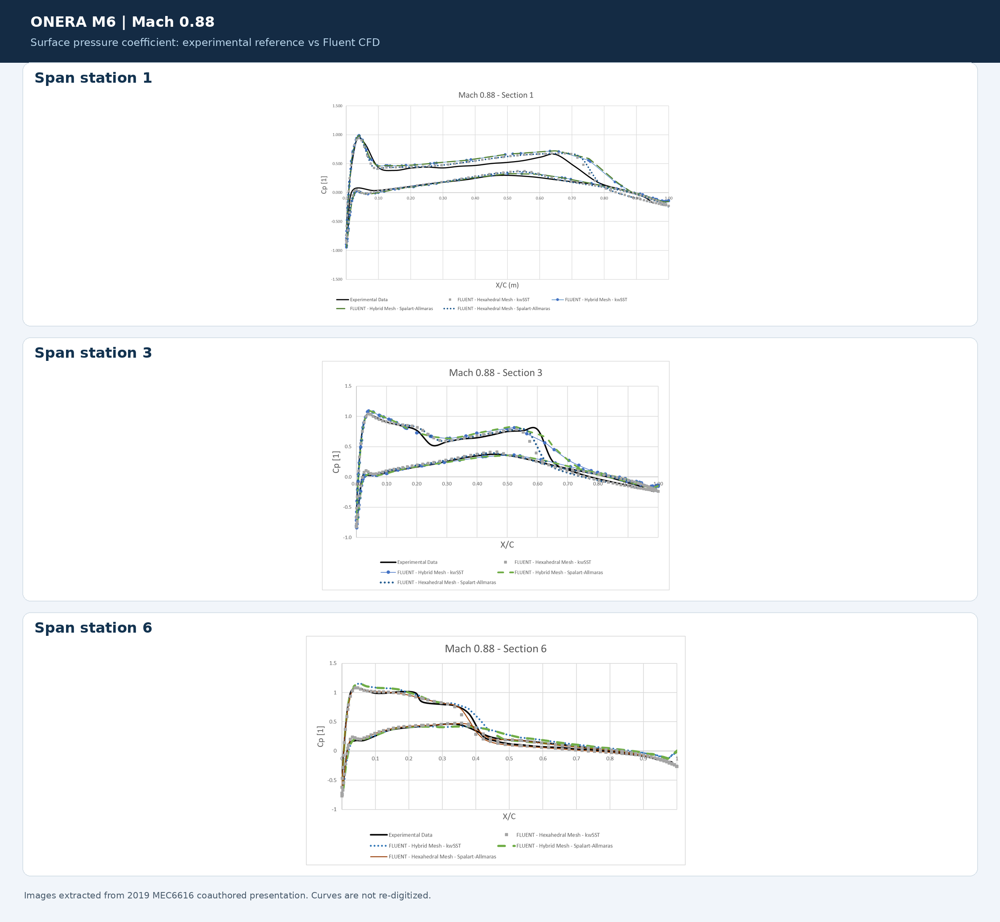

Individual, full-resolution figures: [station 1](cp_m088_station1.png) · [station 3](cp_m088_station3.png) · [station 6](cp_m088_station6.png).

### Findings and limitations reported in the presentation

- The computed **Cp** distributions broadly follow the wind-tunnel measurements at the three selected span stations for both Mach numbers.
- **Hybrid and hexahedral** mesh results were broadly similar. The reported hexahedral predictions aligned better with measurements near some trailing-edge regions.
- The presentation reports **shock-location and trailing-edge discrepancies**, particularly at outer span stations; these discrepancies should not be hidden by a single aggregate accuracy statement.
- At M=0.88, the **inviscid approximation** generally showed weaker agreement around shocks and the trailing edge than the RANS predictions, and the inviscid shock was displaced downstream in the authors' comparison.
- Tests with **Transition SST** did not eliminate the documented discrepancies in the Mach 0.84 station-1 comparison.
- No quantitative global error metric (RMSE, MAE, shock-location error) can be responsibly derived without the underlying numerical and experimental tabulated data.

### Additional comparisons

**Viscous versus inviscid, M=0.88:**

| Station 1 | Station 3 | Station 6 |
|:---:|:---:|:---:|
| 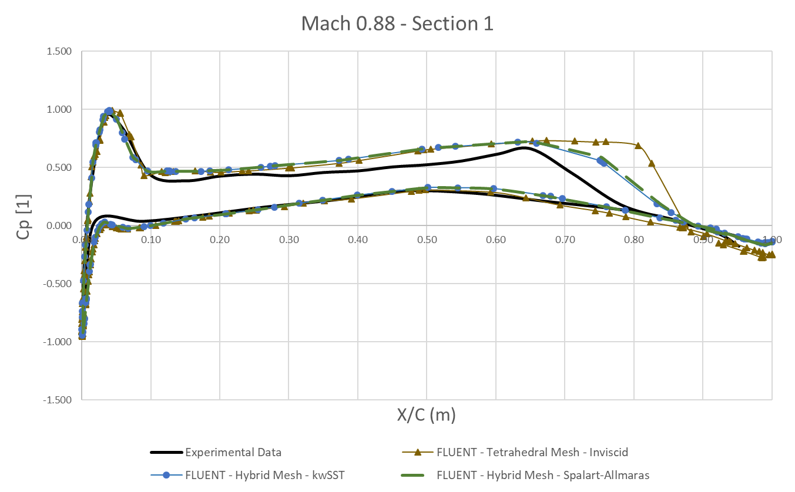 | 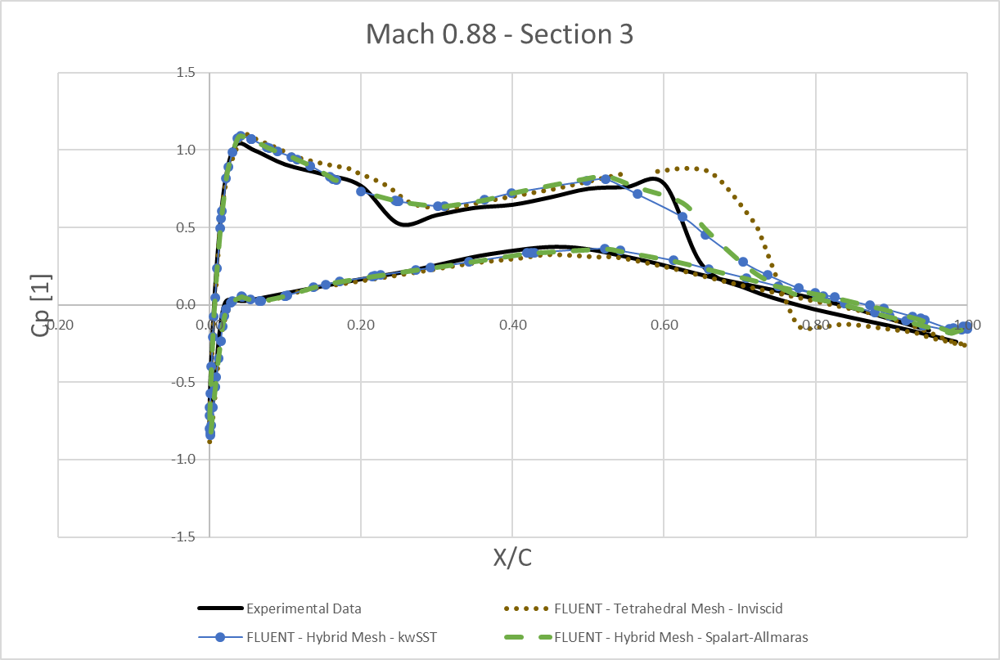 | 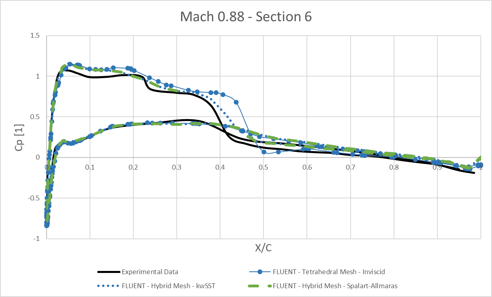 |

**Cross-solver contextual check at M=0.84, station 1:**

| SU2 benchmark plot referenced in the slides | Fluent comparison from the project |
|:---:|:---:|
| 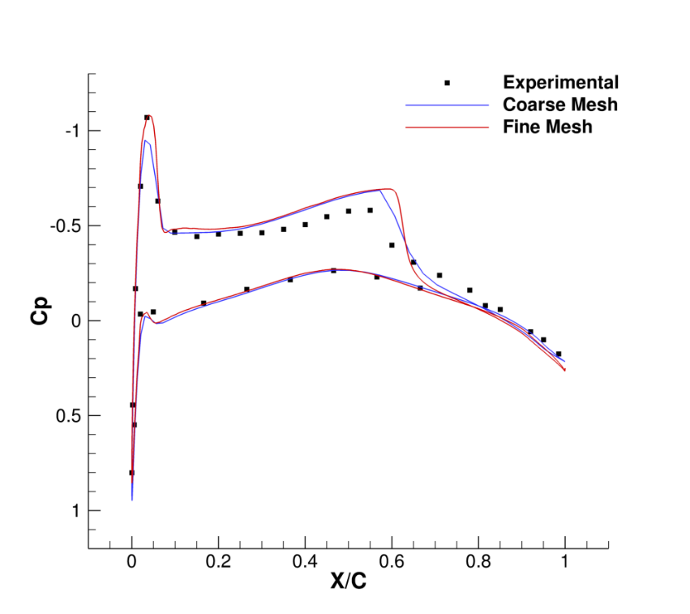 | 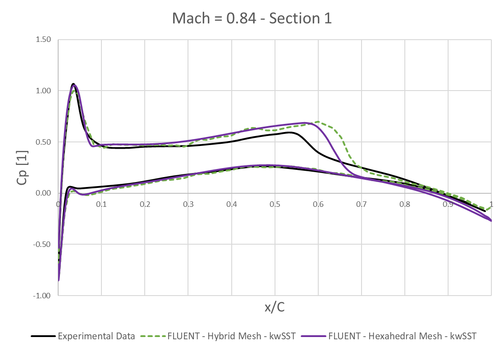 |

The SU2 figure is an external reference plot shown in the original presentation and is **not claimed as a new simulation performed by the authors**. The source presentation states both solvers show a similar deviation near the shock region.

## Experimental benchmark provenance

The ONERA M6 wind-tunnel pressure data are associated with **Schmitt and Charpin (1979), AGARD report AR-138**. NASA publishes experimental **Cp** measurements at seven spanwise stations and documents the classic **Test 2308** benchmark (M≈0.8395, Re≈11.72×10⁶, α=3.06°):

- [NASA Glenn — ONERA M6 Wing validation case and experimental Cp tables](https://www.grc.nasa.gov/www/wind/valid/m6wing/m6wing.html)
- [NASA LAVA — ONERA M6 RANS tutorial and experimental comparison dataset](https://www.nas.nasa.gov/LAVA/unst_docs/tutorials/onera_M6/onera_M6/)
- [SU2 — Turbulent ONERA M6 tutorial](https://su2code.github.io/tutorials/Turbulent_ONERAM6/)

**Important:** The historical measurements shown in the figures are retained *as plotted* in the original project presentation. They have not been reconstructed or independently revalidated here. The experimental source is cited for provenance, not as evidence that the exact original plotted points were re-downloaded from NASA.

## Files and reproducibility

The image files are stored in the **repository root** alongside `README.md`.
This README links directly to them by filename (for example,
`comparison_mach084.png` and `mesh_full.png`).

The repository is a **documented CFD portfolio study**, not yet a reproducible solver benchmark: original Fluent `.cas/.dat` files, mesh files, solver settings exports, and machine-readable pointwise CFD data were **not supplied**. The PNGs show the actual historical results from the presentation. A reusable plotting script is included for when raw curves are available; **no curves or numerical measurements have been invented**.

## What I would add next

- Original Fluent mesh and setup files (only if sharing permissions and software licensing allow)
- Structured Cp exports at each station for both Mach numbers
- Explicit error metrics for Cp and shock location, and revised grid convergence data
- Fully specified boundary conditions, solver discretization settings, and stopping criteria

## Figure provenance and sharing

CFD figures are reproduced from the original jointly prepared project presentation. Experimental pressure-coefficient data originate from historical wind-tunnel measurements, while the SU2 plot is an external reference. Third-party material retains its respective rights. Confirm appropriate permissions before distributing jointly created figures; no license is assigned to these figures in this repository.
